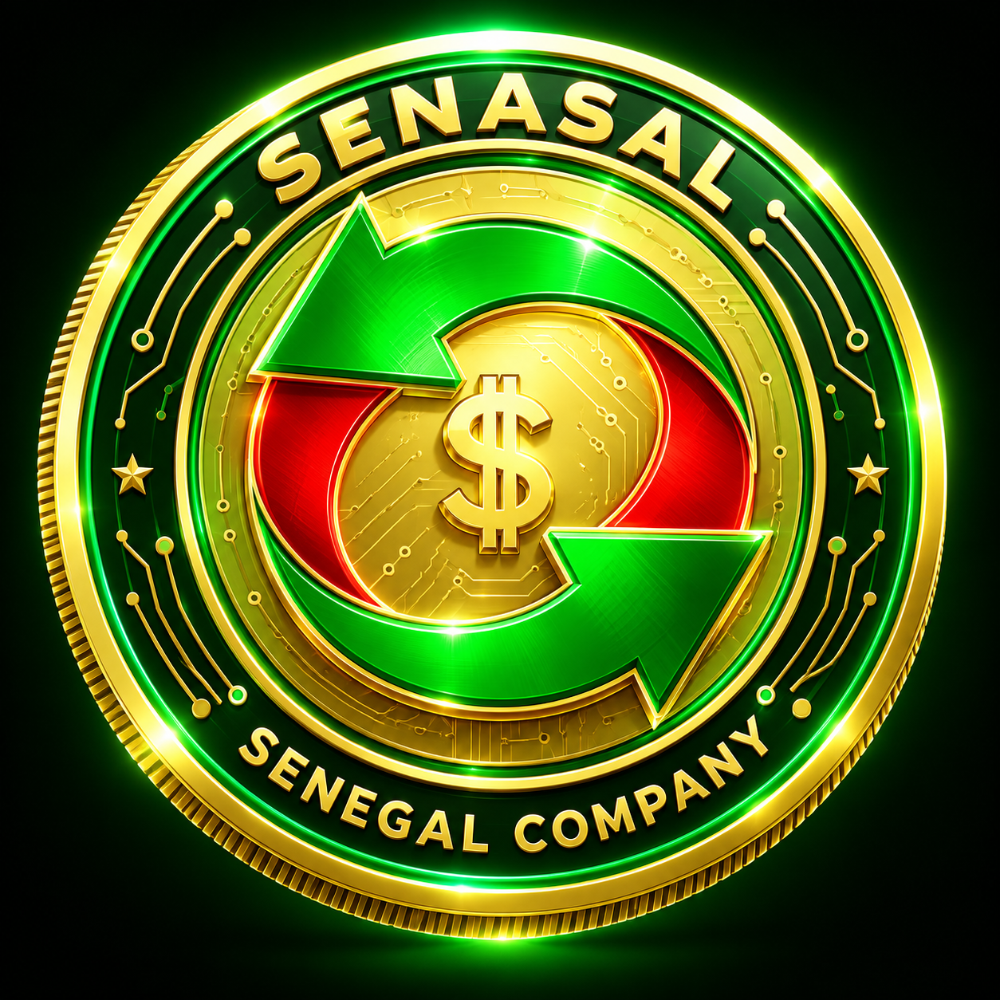
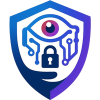
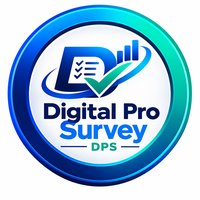
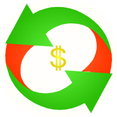

  

<h1 align="center">SNAR SAL | SENASAL</h1>

  <b>Cybersecurity, Web3 and digital commerce, built in Senegal for Africa and the world.</b>

  
  
  
  

---

## 👋 About

I'm **Salif, publicly known as SNAR SAL (SnarSal)**, Founder & CEO of **SENASAL**, a Senegalese company focused on technology, trade and commerce.

We develop concepts for cybersecurity software, artificial intelligence and Web3 products, alongside international trade and commerce activities. The software and service projects described below are at the viability-assessment or design stage; token issuance does not mean a product is available.

---

## 🚀 Projects

| Logo | Project | What it is | Chain |
|---|---|---|---|
|  | **Cyber Shield Device Token (CSDT)** | Our first technology concept, under viability assessment. Proposed software would run on a compatible device and create an autonomous, isolated virtual environment (a virtual interface on top of the host), with built-in antivirus, VPN and eSIM-based connectivity for high-end smartphones. The proposed first version would include an integrated crypto wallet, with CSDT intended as its governance token. No software, beta or download has been released. | Waves |
|  | **Real Crypto Value Chain (RCVC)** | Blockchain-based digital asset project linked to the SENASAL ecosystem and promoted by Snar Sal. It aims to support the exchange of digital value, make cryptocurrency transactions easier and encourage participation in the decentralized economy. Tradable on WX Network (RCVC/XTN pair). *Connecting real value with the digital economy.* | Waves |
|  | **CyberarIA (CYAI)** | Proposed AI-assisted service to help consenting users locate images of themselves that may have been published without permission. Facial recognition, AI agents and CYAI payments remain subject to feasibility, privacy and legal review. No operational service is announced here. | MultiversX |
|  | **TBL TriPool** | Token-based program on MultiversX with monthly rounds, refunds, liquidity locking and staking. Design phase: the full technical specification remains under review and is not yet published. Program contracts and services are not deployed or audited; the token has been created. | MultiversX |
|  | **Digital Pro Survey (DPS)** | Project under viability assessment that would connect businesses and participants through digital surveys, market studies and product or service evaluations. Businesses could launch campaigns to learn what their customers think. Participants could receive rewards for validated answers, in DPS tokens or through traditional payments, subject to campaign rules and feasibility and regulatory review. No live platform exists. *Digital Surveys. Real Insights. Smarter Decisions.* | MultiversX |
|  | **SENASAL (NAL SENEGAL)** | The company's own token. | MultiversX |

---

## 🪙 Token status

The following token details and market status are reported by SENASAL. Market availability can change; check the official identifiers and the relevant platform before acting.

| Token | Chain | Official ID | Supply | Liquidity pools | Market status |
|---|---|---|---|---|
| **CSDT** | Waves | `GbZ28if9n6DQqudzmHPRVCjQaXe1X5KX7TNoUmHgP4q9` | 1,000,000,000 | ✅ WX/CSDT · WAVES/CSDT · XTN/CSDT | Tradable on WX Network |
| **RCVC** | Waves | `E6bmKBwS1CFs3EJ1WrNRzBbMGHitsCwJwf7nyCqWRqYF` | 100,000,000 | ✅ WX/RCVC · WAVES/RCVC · XTN/RCVC | Tradable on WX Network |
| **NAL (SENASAL)** | MultiversX | `NAL-19d7ed` | 84,000,000 | ⏳ Not created yet | No official sale; no liquidity pools created |
| **CYAI** | MultiversX | `CYAI-ffbc62` | 66,933,228 | ⏳ Not created yet | No official sale; no liquidity pools created |
| **TriPool (TBL)** | MultiversX | `TBL-3468ae` | 1,000,000,000 | ⏳ Not created yet | No official sale; no liquidity pools created |
| **DPS** | MultiversX | `DPS-f89ede` | 37,888,888 | ⏳ Not created yet | No official sale; no liquidity pools created |

> ⚠️ **Anti-fraud notice.** Only **CSDT** and **RCVC** are tradable on the decentralized market. **NAL, CYAI, TBL and DPS are not offered for sale by SENASAL.** SENASAL has not authorized sales of these tokens. Any offer claiming to be an official SENASAL sale is unauthorized. Always verify a token by its official ID: any token with the same name but a different ID is not ours.

## NAL and CYAI: token details and administrative properties

The following is a snapshot supplied by SENASAL, not a live or independently verified on-chain feed.

| Field | SENASAL (NAL) | CyberarIA (CYAI) |
|---|---|---|
| Identifier | `NAL-19d7ed` | `CYAI-ffbc62` |
| Decimals | 18 | 18 |
| Total supply | 84,000,000 NAL | 66,933,228 CYAI |
| Circulating supply shown by the explorer | 84,000,000 NAL | 66,933,228 CYAI |
| Owner | `erd1cef4ajjsur96w522artqp4uqv5pjydtugsnuept33pdag0xu3utqj6vvlp` | `erd1cef4ajjsur96w522artqp4uqv5pjydtugsnuept33pdag0xu3utqj6vvlp` |
| Properties shown | Can Upgrade; Can Change Owner; Can Pause; Can Freeze; Can Wipe; Can Add Special Role | Can Upgrade; Can Change Owner; Can Pause; Can Freeze; Can Wipe; Can Add Special Role |
| Pause status shown | Not paused | Not paused |

These are enabled administrative capabilities, not evidence that they have been exercised. Do not describe these tokens as having no administrative controls or as having permanently disabled freeze/wipe capabilities. Check the current explorer state before relying on these details.

The explorer's circulating-supply figure does not establish public distribution, liquidity or trading availability. Holder and transaction counts change and are not presented here as live statistics.

- [NAL explorer](https://explorer.multiversx.com/tokens/NAL-19d7ed)
- [CYAI explorer](https://explorer.multiversx.com/tokens/CYAI-ffbc62)

## 🔐 Official addresses

- **Waves issuer** (CSDT, RCVC): `3P2vn79Hbv447dUABhCCLCpbMtXNw47fXj7`
- **MultiversX owner** (NAL, CYAI, DPS): `erd1cef4ajjsur96w522artqp4uqv5pjydtugsnuept33pdag0xu3utqj6vvlp`
- **MultiversX owner** (TBL): `erd1g568suxmlmw9znwddffnzvcrpw8t26sf9fpn8mu88vur4n06n5pqglt86m`

---

## 🏢 Business lines

- 🛡️ Cybersecurity software
- ⛓️ Web3 and blockchain product development
- 🌍 International trade and imports
- 🛒 Wholesale and retail e-commerce
- 🏗️ Construction equipment rental

---

## 🧰 Stack

---

## 🤝 Open source

Contributor to [`multiversx/mx-assets`](https://github.com/multiversx/mx-assets) · 🦈 Pull Shark

---

## 📫 Contact

- 🌐 Corporate website: [senasal.com](https://senasal.com)
- 🌐 [salif.org](https://salif.org)
- 🐦 [@c_snarsal](https://x.com/c_snarsal)

---

Nothing in this profile or in our repositories is financial advice or an offer of securities. Crypto assets are volatile and you can lose all of your money. Our projects are currently undergoing a viability assessment; SENASAL has not authorized sales of NAL, CYAI, TBL or DPS and has not created liquidity pools for them. Always verify token IDs from this page.
